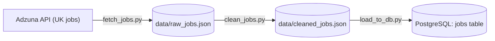

# Labour Market Intelligence Pipeline

A batch ETL pipeline that collects job postings from the Adzuna API, cleans them and loads them into PostgreSQL, so that skill and salary trends can be analysed over time with SQL.

> **Status: work in progress.** The fetch, clean and load stages work end to end. Skill extraction, analysis queries and a dashboard are not built yet (see the roadmap below).

## Why this project

Job postings are spread across many sites and change every day, which makes it hard to see which skills employers ask for and what they pay. This project collects postings into one database, run after run, so those questions can be answered with SQL.

## Architecture



- **Extract** (`src/fetch_jobs.py`): queries the Adzuna API for four search terms and saves the raw response.
- **Transform** (`src/clean_jobs.py`): removes duplicate postings, keeps the fields that are needed and computes the average salary.
- **Load** (`src/load_to_db.py`): inserts the cleaned postings into PostgreSQL.
- **Orchestration** (`run_pipeline.py`): runs the three steps in order and stops at the first failure.

The pipeline is a batch job: it runs when started and is not real time.

## Tech stack

| Area | Tools |
|---|---|
| Language | Python 3.14 |
| Source | Adzuna Jobs API (`requests`) |
| Storage | PostgreSQL 18 (`pg8000` driver) |
| Config and secrets | `python-dotenv` (`.env` file, not committed) |
| Version control | Git and GitHub |

## Project structure

```
.
├── run_pipeline.py        # runs fetch -> clean -> load
├── requirements.txt
└── src/
    ├── fetch_jobs.py      # extract from the Adzuna API
    ├── clean_jobs.py      # deduplicate and clean
    ├── create_table.py    # create the jobs table (run once)
    └── load_to_db.py      # load into PostgreSQL
```

The `data/` folder and the `.env` file are created locally and are not part of the repository.

## Data model

Table `jobs`:

| Column | Type | Notes |
|---|---|---|
| `id` | TEXT, primary key | Adzuna job id |
| `title` | TEXT | Job title |
| `company` | TEXT | Company name |
| `location` | TEXT | Location as shown by Adzuna |
| `salary_min`, `salary_max` | NUMERIC | NULL when the posting has no salary |
| `avg_salary` | NUMERIC | Average of min and max, NULL when either is missing |
| `search_term` | TEXT | The query that returned the job |
| `created` | TIMESTAMPTZ | Posting date reported by Adzuna |

## Setup and run

1. Install Python and PostgreSQL, and create a free Adzuna developer account to get an app id and app key.
2. Clone the repository and create a virtual environment:

```bash
git clone https://github.com/umair-nazir1/labourmarketintelligencepipeline.git
cd labourmarketintelligencepipeline
python -m venv venv
# Windows PowerShell: .\venv\Scripts\Activate.ps1
# macOS or Linux:     source venv/bin/activate
python -m pip install -r requirements.txt
```

3. Create a PostgreSQL database named `labour_market`.
4. Create a `.env` file in the project root:

```
ADZUNA_APP_ID=your_app_id
ADZUNA_APP_KEY=your_app_key
DB_PASSWORD=your_postgres_password
```

5. Create the table once, then run the pipeline:

```bash
python src/create_table.py
python run_pipeline.py
```

Running the pipeline again is safe: jobs that are already in the table are skipped.

## Design decisions

- **Idempotent load.** `id` is the primary key and the insert uses `ON CONFLICT DO NOTHING`, so running the pipeline many times never creates duplicates.
- **Fail fast.** The fetch step exits with an error when no jobs come back, and it does not overwrite the previous raw file. The runner stops at the first failing step and passes on its exit code.
- **Secrets stay out of the code.** Credentials are read from environment variables loaded from a `.env` file that is git-ignored.
- **Parameterized queries.** Values are passed as parameters instead of being pasted into the SQL text.
- **Pure-Python driver.** `pg8000` is used instead of `psycopg2` because the compiled `psycopg2` binary was blocked by Windows Smart App Control on the development machine.

## Known limitations

- **UK data.** Adzuna does not offer a Pakistan endpoint, so the project currently uses the UK (`gb`) data.
- **Small dataset.** Each run fetches 10 results for each of 4 search terms. The table only grows as the pipeline is run again.
- **Salary quality.** Adzuna marks some salaries as predicted. That flag is not stored yet, so `avg_salary` mixes published and estimated values.
- **Duplicates by id only.** The same job reposted under a different id is treated as a new job.
- **Manual runs.** There is no scheduler yet.
- **No automated tests yet.**

## Roadmap

- [x] Ingest postings from the Adzuna API
- [x] Clean and deduplicate
- [x] Idempotent load into PostgreSQL
- [x] Pipeline runner that stops on failure
- [ ] Store the `salary_is_predicted` flag and a `loaded_at` timestamp
- [ ] Extract skills from job descriptions
- [ ] SQL analysis: most requested skills, salary by skill
- [ ] Dashboard
- [ ] Scheduling (Airflow)
- [ ] Tests and data quality checks
- [ ] Cloud deployment (AWS)